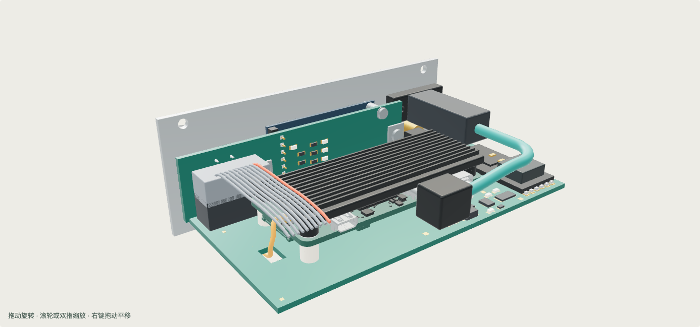

# Slewn Air V20 最终版 · Wireless ES-9

手机上的 Slewn 通过 Wi-Fi 发送音符和 CV，Radxa ZERO 3W 通过 USB 控制 Expert Sleepers ES-9。硬件采用 Intellijel 1U、22 HP 面板和 Eurorack +12 V 供电。

## 下载

[最终版完整包](https://github.com/Hal-cell/slewn-wireless-es9/releases/download/v20/Slewn-Air-V20-22HP-Final.zip)包含可离线旋转的整机、Blender 文件、尺寸图和两套 PCB 工程。[板厂包](https://github.com/Hal-cell/slewn-wireless-es9/releases/download/v20/Slewn-Air-V20-22HP-Fabrication.zip)包含可编辑 KiCad 10 工程、中文 BOM、独立 Gerber 和首件贴片坐标。

| 电路板 | KiCad 工程 | 制造文件 |
|---|---|---|
| MAIN 主板 | [工程](设计/MAIN/Slewn_V20_MAIN.kicad_pro) · [PCB](设计/MAIN/Slewn_V20_MAIN.kicad_pcb) | [Gerber](设计/MAIN/MAIN-制板-Gerber.zip) · [BOM](设计/MAIN/MAIN-BOM.xlsx) |
| UI 面板板 | [工程](设计/UI/Slewn_V20_UI.kicad_pro) · [PCB](设计/UI/Slewn_V20_UI.kicad_pcb) | [Gerber](设计/UI/UI-制板-Gerber.zip) · [BOM](设计/UI/UI-BOM.xlsx) |

## 两板如何插合

MAIN 的 J2 采用金航标成品 90° 公排针 **KH-2.54PH90-1X14P-L13.8**，UI 的 J101 采用 8.5 mm 直排母 **KH-2.54FH-1X14P-H8.5**。两件均为 1×14、2.54 mm 间距，每台各用一个。[立创公针 C2905430](https://item.szlcsc.com/3175218.html) · [立创排母 C2905420](https://item.szlcsc.com/3175194.html)

公针朝面板，排母开口朝机箱后方。将主板水平推向面板，至角码孔自然对齐后锁螺钉。14 根针的名义插深为 **5.15 mm**，两塑壳间隙 **0.85 mm**。母座弹片的有效接触范围和焊后的插拔手感须由首件验证。[插接侧剖图](预览/05-板间连接器侧剖.png) · [尺寸与元件摆位](V20-尺寸与元件摆位.pdf) · [Blender 总装](设计/V20-直角总装.blend)

从面板背面到短侧出 USB 插头最深处为 **66.50 mm**，距 73 mm 上限余 6.50 mm。按 22.50 mm 导轨开口核对，上、下名义余量分别为 0.75 mm 和 0.60 mm。下载完整快照后可双击打开查看器并拖动插合行程。[离线查看器](打开%20V20%20整机.html) · [装配核对](核对/V20-插合与间隙.json)

## 首件制板

两板均为双层 1.60 mm FR-4，35 μm 铜，ENIG 沉金。KiCad 10.0.8 检查记录显示，两板 ERC、DRC、未连和原理图差异均为零。MAIN 的 **15 个指定过孔**要求树脂填孔并双面镀铜盖孔。首件以 R20 留空、限流电源和假负载分级验证，之后接入 Radxa。[制造与上电说明](设计/板厂与首件说明.txt) · [检查结果](核对/V20-打板与逐针核对.json)

随附封装和 STEP 模型的来源列于各板工程中。[MAIN 库来源](设计/MAIN/Libs/LICENSE-SOURCES.txt) · [UI 库来源](设计/UI/Libs/LICENSE-SOURCES.txt)
